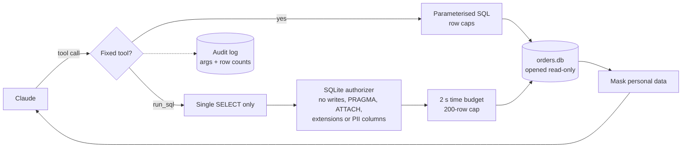

# ec-orders-mcp

[](https://github.com/yahayuta/ec-orders-mcp/actions/workflows/ci.yml)

A **read-only [MCP](https://modelcontextprotocol.io) server** that lets Claude (or any MCP
client) answer questions about an online shop's orders, without being able to change data
or see customers' personal information.

Business teams want to ask "how did each channel do last month?" in plain language. The
hard part is not the connection; it is making that access **safe enough to switch on**.
This project is a small, tested example of how to do that.

All data is synthetic and generated locally.

## What Claude can do with it

| Tool | Purpose |
|---|---|
| `describe_schema` | Tables, columns and how revenue and dates are defined |
| `search_orders` | Filter orders by status, channel, date range or customer |
| `get_order` | One order with its lines and a **masked** customer profile |
| `sales_summary` | Revenue, orders and AOV by day, week, month, channel or category |
| `top_products` | Best sellers by revenue or quantity |
| `run_sql` | One guarded, read-only `SELECT` for questions the tools above cannot answer |

It also provides a `schema://tables` resource and a `monthly_report` prompt that asks for a
manager-ready summary for a given month.

Example questions:

- "Which channel had the highest average order value in Q1?"
- "Show me the cancelled orders from own_store in March."
- "What are the top five products by quantity this year, and which categories are they in?"
- "Write the monthly report for 2025-06."

## Safety by design

Every layer assumes the one before it might fail:



| Layer | What it prevents |
|---|---|
| Database opened with `mode=ro` | Any write, even if every other check is bypassed |
| Fixed, parameterised tools first | SQL injection and unbounded queries for common questions |
| `run_sql` accepts one `SELECT` / `WITH` statement | Statement stacking (`SELECT 1; DROP ...`) |
| SQLite authorizer | Writes, `PRAGMA`, `ATTACH`, `load_extension`, catalog tables, and reading `customers.name`, `email`, `phone` |
| Time budget and row cap | Runaway queries (e.g. infinite recursive CTEs) and huge result sets |
| Masking in `get_order` | Personal data leaving the server (`c***2@example.com`, `***-****-5678`) |
| Tool annotations | Clients see every tool as `readOnlyHint: true`, `destructiveHint: false` |
| Audit log (JSONL) | Unaccountable access: who asked what, how many rows, how long; results are never logged |

Rejected queries come back to the model as a clear tool error ("Personal data ... is not
available through SQL"), so it can rephrase instead of retrying blindly. Each of these
rules has a test.

## Use it with Claude

Requires Python 3.11+.

```bash
git clone https://github.com/yahayuta/ec-orders-mcp.git
cd ec-orders-mcp
pip install -e .
python -m ec_orders_mcp.data --db data/orders.db   # optional: created on first start anyway
```

**Claude Code**

```bash
claude mcp add ec-orders -e EC_MCP_DB="$PWD/data/orders.db" -- python -m ec_orders_mcp
```

**Claude Desktop** (`claude_desktop_config.json`)

```json
{
  "mcpServers": {
    "ec-orders": {
      "command": "python",
      "args": ["-m", "ec_orders_mcp"],
      "env": {
        "EC_MCP_DB": "/absolute/path/to/ec-orders-mcp/data/orders.db",
        "EC_MCP_AUDIT_LOG": "/absolute/path/to/ec-orders-mcp/data/audit.jsonl"
      }
    }
  }
}
```

| Variable | Default | Meaning |
|---|---|---|
| `EC_MCP_DB` | `data/orders.db` | SQLite file (generated if missing) |
| `EC_MCP_AUDIT_LOG` | not set | Path of the JSONL audit log |

## Tests

```bash
pip install -e ".[dev]"
pytest -q
```

23 tests cover the query guard (writes, stacking, `PRAGMA`, `ATTACH`, extensions, catalog
and PII access are all rejected), masking, row caps, the time budget, the read-only
connection, the audit log, consistency between tools and raw SQL, and the server itself,
both in-process and launched over **stdio** the way Claude Desktop starts it. CI runs them
on Python 3.11 to 3.13.

## Design notes

- **Tools before SQL.** Most business questions fit a handful of well-named, parameterised
  tools. They are faster, cheaper in tokens and easier to audit than free-form SQL, which
  stays available as a guarded fallback.
- **Define the metric once.** "Revenue counts completed orders only" lives in the store and
  in `describe_schema`, so the model and the tests use the same definition.
- **Errors are for the model.** Messages explain what is not allowed and why, so the next
  call is better rather than a retry of the same mistake.
- **Swap the backend, keep the contract.** The store is a thin class over SQLite; pointing
  it at BigQuery or a replica means re-implementing six methods, not the server.

## Repository layout

```
ec_orders_mcp/
  data.py     synthetic database generator (deterministic)
  store.py    read-only queries, SQL guard, masking, audit log
  server.py   MCP tools, resource and prompt
tests/        store and guard tests, MCP tests in-process and over stdio
```

## License

MIT
